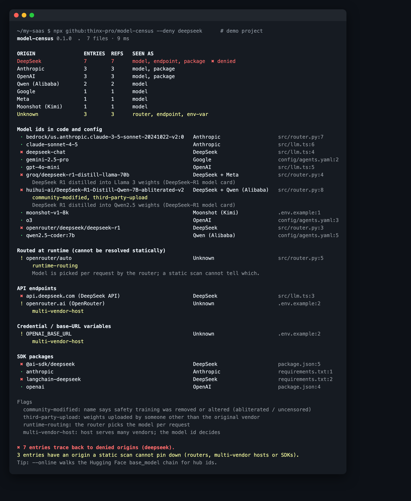

# model-census

**Which AI models does this codebase reference, and whose weights are they built on?**
An offline scan of code, config, `.env` files and dependency manifests that maps every model id, API endpoint and SDK to the vendor behind it, including distilled and fine-tuned derivatives. One command, no install, no API key.

   

```bash
npx github:thinx-pro/model-census --deny deepseek
```



**Try it in the browser:** paste code, or trace a Hugging Face model's lineage → **https://thinx-pro.github.io/model-census/**

## Why

On 19 October 2026 Reuters reported that the US Department of Homeland Security ordered federal civilian agencies to remove DeepSeek products *and third-party services that use the model*, and to stop buying them ([BNN Bloomberg / Reuters](https://www.bnnbloomberg.ca/business/international/2026/10/19/us-banning-chinese-ai-deepseek-from-government-agency-it-systems/)). If you sell software to those agencies, or to anyone who copies their questionnaire, you now need to answer "which models does your product use?" with evidence.

That is harder than it sounds:

- Model ids are scattered across code, YAML, `.env` files and LiteLLM/OpenRouter routing tables.
- Derivatives hide their origin: `groq/deepseek-r1-distill-llama-70b` is DeepSeek R1 distilled into Llama weights; `DeepCoder-14B` is a fine-tune of a DeepSeek distill.
- Some ids are decided at runtime (`openrouter/auto`), so no static answer exists, and you should know where those are.
- Community re-uploads change names. The same day, ProjectDiscovery showed a backdoored open-weight model exfiltrating `.env` and SSH keys inside Codex CLI ([write-up](https://projectdiscovery.io/research/how-abliterated-models-can-get-you-pwned)). Knowing which "abliterated" or third-party weights you run locally is now a supply-chain question.

Existing AI-BOM tools (e.g. Snyk's `aibom`, [Trusera/ai-bom](https://github.com/Trusera/ai-bom)) inventory models and agents in code. model-census focuses on one question they don't answer directly: **what is each model built on**, with a CI exit code for a deny list.

## Quick start

```bash
# 1. scan the current repo
npx github:thinx-pro/model-census

# 2. fail CI if anything traces back to a denied origin
npx github:thinx-pro/model-census --deny deepseek

# 3. include models on this machine and walk Hugging Face lineage
npx github:thinx-pro/model-census --local --online

# 4. (new in 0.2) which AI models are credited in the git history?
npx github:thinx-pro/model-census --commits --deny deepseek
```

## New in 0.2: which model wrote the code? (`--commits`)

The DHS order's wording also covers products *"developed using"* DeepSeek, and the HN thread spent [500+ comments](https://news.ycombinator.com/item?id=50154244) on whether that includes code a model generated. Nobody knows yet how it will be read. But if a customer asks, the evidence you already have is in your git history: coding agents leave `Co-Authored-By` trailers, signatures and bot accounts.

`--commits` reads commit metadata only (author, trailers, message footer, never diffs) and reports which tools and models are credited, grouped by the vendor whose weights were used. With `--deny`, it exits 1 if any commit credits a denied origin. Real output on [aider](https://github.com/Aider-AI/aider)'s own history (13,139 commits, run in 139 ms):

```text
model-census --commits  aider  (13,139 commits, 2023-04-03 → 2026-05-22, 139 ms)
4,390 commits (33%) credit an AI tool or model; 67 name the model.

By origin of the weights
     4323  98%    tool only, model not stated
       36  0.8%   OpenAI
       30  0.7%   Google
        1  0.0%   Anthropic

By tool and model
  commits  tool             model                              origin             first      → last
     4323  aider            (model not stated)                 ?                  2023-05-09 → 2025-06-25
       13  aider            vertex_ai/gemini-2.5-pro-exp-03-2… Google             2025-04-12 → 2025-04-12
       10  aider            gemini/gemini-2.5-pro              Google             2025-06-25 → 2025-08-13
        9  aider            openai/gpt-5.2                     OpenAI             2026-02-11 → 2026-02-11
        …
        1  Claude Code      claude-opus-4.6                    Anthropic          2026-02-16 → 2026-02-16

OK — no commit credits a model from DeepSeek
```

What it recognises: model names in `Co-authored-by` / `Assisted-by` / `Generated-by` trailers (`Claude Opus 4.6 <noreply@anthropic.com>`, `aider (deepseek/deepseek-chat)`, `Qwen Code:qwen3-coder-plus`), tool signatures (`Generated with Claude Code`, aider's `(aider)` author suffix), and agent accounts (Codex, Copilot, Cursor Agent, Jules, Devin, Gemini CLI, OpenCode, Qwen Code, Kimi CLI, Amazon Q/Kiro). A tool's default vendor is used only when no model is named, and multi-vendor tools (Copilot, Cursor, aider, OpenCode, Devin) stay "model not stated" unless the trailer names one. Human co-authors are ignored.

**How I checked it:** on aider (13,139 commits) and [opencode](https://github.com/sst/opencode) (28,029 commits; 405 attributed, 62 to Anthropic models by name), I hand-checked 40 randomly chosen attributions: 38 were right. The 2 wrong ones were people whose e-mail address contained "opencode"; a third pattern of the same kind (a username containing "devin") turned up while I was building it. All three are fixed and have regression tests, so the 38/40 is from before the fix. I also listed every Co-authored-by trailer the tool did *not* attribute in both repos (top 40 by count): all were people, CI accounts or review bots, so no AI tool was missed there.

**What it cannot tell you:** a commit with no trailer is not evidence that a person wrote it. Most tools add trailers only when configured to, and people delete them. This is the evidence your history *declares*, which is what you can show a customer, not a detector of AI-written code. `--since 2026-01-01`, `--json` and `--md` work as usual.

## What it finds

| Kind | Examples | How |
|---|---|---|
| Model ids | `deepseek-chat`, `claude-sonnet-4-5`, `qwen2.5-coder:7b`, `bedrock/us.anthropic.claude-…-v2:0`, `fireworks_ai/accounts/fireworks/models/deepseek-v3`, `hf.co/org/repo:Q4_K_M` | string literals and `model:` / `MODEL=` / `--model` values, parsed for route (OpenRouter, Bedrock, Vertex, Fireworks, Groq, Together, Ollama, LiteLLM prefixes) and author |
| Derivatives | `deepseek-r1-distill-qwen-*`, `deepseek-r1-distill-llama-*`, `r1-1776`, `MAI-DS-R1`, `DeepScaleR`, `DeepCoder` | built-in table; each entry names its public source (model card) |
| Runtime routing | `openrouter/auto` | reported separately: origin unknown |
| Endpoints | `api.deepseek.com`, `dashscope.aliyuncs.com`, `open.bigmodel.cn`, `openrouter.ai`, `bedrock-runtime.*`, `localhost:11434` | 28 hosts; multi-vendor hosts are marked as such |
| Credential variables | `DEEPSEEK_API_KEY`, `MOONSHOT_API_KEY`, `OPENROUTER_API_KEY` | names only; values are never read into the report |
| SDK packages | `@ai-sdk/deepseek`, `langchain-deepseek`, `zhipuai`, `dashscope`, `openai`, `litellm` | `package.json`, `requirements*.txt`, `pyproject.toml`, `Pipfile`, `setup.cfg` |
| Local models (`--local`) | Ollama manifests, Hugging Face cache, LM Studio | GGUF headers are read (never the weights): `general.base_model.*` and the tokenizer |
| Lineage (`--online`) | `huihui-ai/…-abliterated-v2 ← deepseek-ai/DeepSeek-R1-Distill-Qwen-7B` | walks `base_model` on the public Hugging Face API, up to 8 levels |

23 origin families: DeepSeek, OpenAI, Anthropic, Google, Meta, Mistral, Qwen (Alibaba), Moonshot, Zhipu/Z.ai, MiniMax, xAI, Cohere, Microsoft, NVIDIA, Amazon, AI21, IBM, Perplexity, Baidu, Tencent, ByteDance, 01.AI, Inception.

Flags:

- `community-modified`: the name says safety training was removed or altered (abliterated, uncensored).
- `third-party-upload`: weights published by someone other than the original vendor (a quantizer or fine-tuner).
- `undeclared-lineage`: the tokenizer carries DeepSeek's special tokens (`<｜begin▁of▁sentence｜>`) but the metadata does not declare a DeepSeek base. Those tokens survive renaming and re-uploading.
- `runtime-routing`, `multi-vendor-host`, `multi-vendor-sdk`: the origin cannot be known statically.

## Output formats

```bash
model-census --json        # everything, machine-readable
model-census --md          # inventory table to paste into a security questionnaire or PR
model-census --cyclonedx   # CycloneDX 1.6: models as machine-learning-model components, endpoints as services
```

Exit codes: `0` ok, `1` something traces back to a `--deny` origin, `2` usage error.

Other options: `--docs` also scans `.md/.txt/.rst`; `--exclude test,fixtures` skips paths; `--help`.

## How well does it work?

I ran it on five public repos (shallow clones, October 2026) and read the results by hand:

| Repo | Entries | What I checked | Result |
|---|---|---|---|
| Aider-AI/aider (`aider/`, without website) | 189 | DeepSeek / Meta / unknown / flagged entries | after fixes: no false positives in that subset; 13 DeepSeek entries, all real (`deepseek/deepseek-chat`, Fireworks `deepseek-v3`, OpenRouter `:free` variants, `DEEPSEEK_API_KEY`) |
| simonw/llm | 71 | all entries | 1 non-model (`"gpt-"`, a prefix string) → fixed |
| openai/openai-agents-python | 171 | all entries | 7 non-models (`openai.AsyncOpenAI`, `openai/example`, …) → fixed |
| continuedev/continue | 760 | random sample of 60 | 55 real model references, 3 fake ids used in tests (`gpt-llama`), 2 non-models (`gpt-tokenizer` package name, a camelCase identifier) → fixed afterwards |
| browser-use/browser-use | — | random sample of 40, after all fixes | 40/40 real model references |

The first four were used to tune the rules, so their numbers are not independent. browser-use was not used for tuning. A reference in a test file or a model catalog is still counted; use `--exclude` if you only want production paths.

## How it works

1. Walk the tree (skips `node_modules`, `.git`, build output, lock files, files over 1 MB, minified code).
2. Pull candidate strings from each line: quoted literals and `key: value` pairs whose key mentions model/engine/llm.
3. Parse each candidate into route, author and model name, then match it against the family table, the derivative table and the org table. Short or generic ids (`o3`, `grok`) only count when the line talks about a model; bare words like `"qwen"` only count on an assignment.
4. Group by id, attach every location, apply `--deny`, render.

Zero dependencies. The browser page imports the same `catalog.js` / `extract.js` / `hf.js` modules (copied into `docs/lib` by `scripts/build-docs.js`; a test checks they are in sync).

Privacy: nothing leaves your machine unless you pass `--online`, which sends model ids (not code) to `huggingface.co`. Paths under your home directory are shown as `~`.

## Limitations

- It finds **references**, not traffic. A model listed in a config table may never be called, and a model chosen from a database row at runtime will not be found. For runtime evidence, pair it with your gateway or proxy logs.
- The family and derivative tables are hand-maintained and not exhaustive. Unknown ids are skipped, not guessed. PRs with a source link are welcome.
- Lineage is what uploaders declared. A model whose uploader removed `base_model` and changed the tokenizer will not be caught. The tokenizer check only knows DeepSeek's special tokens.
- Gated Hugging Face models (for example `perplexity-ai/r1-1776`) return 401 without a token; model-census does not ask for one and reports the gap.
- This is not legal advice. Whether a given derivative or self-hosted copy falls under a policy is for your counsel to decide; the tool gives them the list.

## Roadmap

- Read LiteLLM / OpenRouter / proxy logs to add runtime evidence next to static references.
- Weight fingerprints (compare tensor hashes against known bases) for local GGUF and safetensors.
- License checks (revenue thresholds such as Llama's and Mistral's research licenses) in the CycloneDX output.
- A GitHub Action recipe.

## License

MIT

---

### 中文说明

model-census：扫描代码、配置、`.env` 和依赖清单，列出项目里引用了哪些 AI 模型、端点和 SDK，并按「权重来自谁」归类（包括蒸馏、微调的衍生模型，例如 `deepseek-r1-distill-llama-70b` 归为 DeepSeek + Meta）。`--deny deepseek` 在发现相关引用时以退出码 1 结束，可放进 CI；`--local` 列出本机 Ollama / Hugging Face 缓存 / LM Studio 里的模型并读取 GGUF 头部；`--online` 通过 Hugging Face 公共 API 追溯 `base_model` 链；`--cyclonedx` 输出 CycloneDX 1.6 清单。默认完全离线、零依赖：`npx github:thinx-pro/model-census`。网页版：https://thinx-pro.github.io/model-census/ 。它只找「引用」，不代表运行时真的调用了；是否落入某项政策的范围请咨询法务。

**0.2 新增 `--commits`**：DHS 禁令里的「developed using」让问题扩展到「代码是不是用 DeepSeek 写的」。`--commits` 只读 git 提交的元数据（作者、Co-Authored-By 等 trailer、工具签名、Agent 账号，不读 diff），统计哪些提交署名了哪个 AI 工具或模型，并按「权重来自谁」归类；配合 `--deny deepseek` 命中即退出码 1。注意：没有 trailer 不代表是人写的，这只是历史里「自己声明」的证据。
